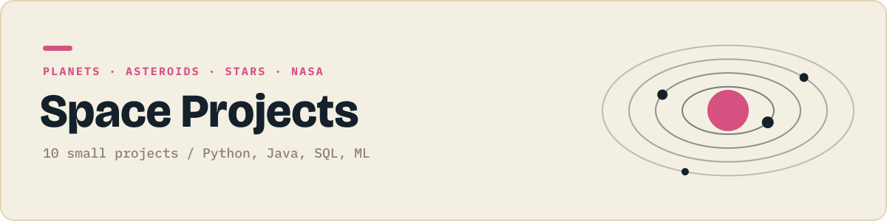

<p align="center"></p>

<p align="center">
  
  
</p>

Planets, asteroids and stars using real NASA data.

Each folder is one small, self contained project that does one thing. They get harder as the numbers go up: first scripts, then data and charts, then Java, SQL and APIs, then a first machine learning model.

## Projects

| # | Project | What it does | Language | Status |
|:-:|---|---|:-:|:-:|
| 01 | Your age on other planets | Converts your age into years on each planet. |  | 🔜 |
| 02 | Your weight on other planets | Converts your weight using each planet's gravity. |  | ⬜ |
| 03 | NASA picture of the day | Downloads NASA's Astronomy Picture of the Day. |  | ⬜ |
| 04 | Who is in space right now | Lists everyone currently in space from a live API. |  | ⬜ |
| 05 | Planets dataset | Charts planet sizes, moons and distances. |  | ⬜ |
| 06 | Live ISS position | Plots where the space station is right now. |  | ⬜ |
| 07 | Solar system scale model | Prints the solar system shrunk to a football pitch. |  | ⬜ |
| 08 | Meteorite landings map | Maps every recorded meteorite landing. |  | ⬜ |
| 09 | Exoplanet discoveries by year | Queries NASA's exoplanet list in SQLite. |  | ⬜ |
| 10 | Star type classifier | Classifies stars with a decision tree. |  | ⬜ |

✅ done &nbsp; 🔜 up next &nbsp; ⬜ planned

## Running a project

```bash
git clone https://github.com/JilkaTeerth/space-projects.git
cd space-projects/01-...
```

Every folder has its own README with the exact commands. Python projects need `pip install -r requirements.txt`, Java projects compile with plain `javac`.

---

<sub>Part of a series of six project collections. See them all at [github.com/JilkaTeerth](https://github.com/JilkaTeerth).</sub>
